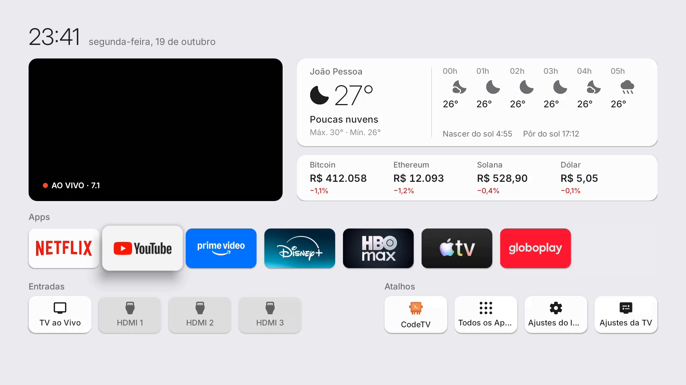
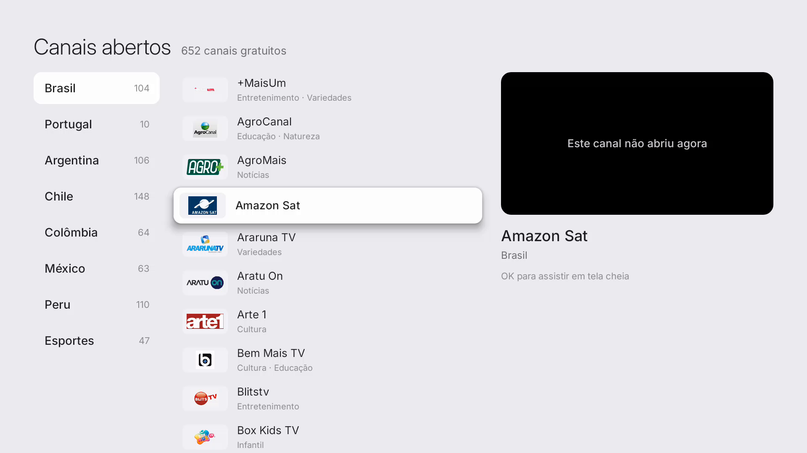

# CodeTV

**Uma tela inicial leve para TVs Android antigas, com a TV aberta ao vivo na tela e mais de 600 canais gratuitos.**

Troque o Início de fábrica, pesado e cheio de propaganda, por uma tela limpa. Ela tem a TV aberta da antena passando num
quadro, o clima, os seus apps, as entradas HDMI e o **CodeTV**, um guia com canais abertos do Brasil, de Portugal, da
América Latina e de esportes.

Este projeto é uma adaptação do [Free My TV](https://github.com/simbasjungles/free-my-tv), de
[@simbasjungles](https://github.com/simbasjungles), para TVs com **Android 9**. O original pede Android 12 ou mais
novo. Foi feito com o [Claude Code](https://claude.com/claude-code) numa TCL BeyondTV de 50" com 2 GB de memória.

> Não tem ligação com a Anthropic, a TCL, o Google nem as emissoras. O robozinho do ícone é um desenho original.



---

## O que vem nele

**Tela inicial**
- **TV aberta ao vivo num quadro:** o último canal da antena que você assistiu fica passando ali, sem som. Um OK abre
  em tela cheia.
- **Relógio, clima** (hora a hora, nascer e pôr do sol) e **cotações** (Bitcoin, Ethereum, Solana, dólar).
- **Seus apps de streaming** numa fileira (Netflix, YouTube, Prime Video, Disney+, Max, Apple TV, Globoplay…).
- **Entradas HDMI** e **atalhos**: CodeTV, Todos os Apps e os ajustes.

**CodeTV, o guia de canais gratuitos**



- **652 canais abertos**, testados um por um: Brasil, Portugal, Argentina, Chile, Colômbia, México, Peru e Esportes.
- Lista em ordem alfabética, com logo, nome e categoria, e uma **prévia ao vivo** do canal selecionado.
- **OK** abre em tela cheia, **▲ ▼** trocam de canal e **Voltar** retorna.
- Aparece também como um app próprio, **CodeTV**, na lista de apps da TV.

**Mais leve**
- Desliga o Início de fábrica e alguns apps de propaganda. Nada é desinstalado, e um botão devolve tudo como era.
- Na TV de teste, a memória livre subiu de ~440 MB para ~610 MB.

> **Só canais gratuitos.** O CodeTV usa as listas públicas do [iptv-org](https://github.com/iptv-org/iptv) e tira
> qualquer canal pago (ESPN, Premiere, SporTV, HBO, Telecine, Globo ao vivo…), porque nessas listas eles são
> retransmissões sem autorização. Também ficam de fora os canais do Pluto TV, que trazem a propaganda do app.

---

## Funciona na minha TV?

- **Android TV ou Google TV com Android 9 ou mais novo.** Para conferir: Configurações → Preferências do dispositivo →
  Sobre → Versão.
- Testado numa **TCL** (BeyondTV, Android 9). Em outras marcas a tela e o CodeTV funcionam, mas a lista de apps de
  propaganda a desligar é da TCL. O [CLAUDE.md](CLAUDE.md) explica como adaptar.
- O quadro de TV aberta precisa de **antena ligada** e dos canais já sintonizados na TV.
- Samsung e LG não rodam Android: nelas, use um aparelho Google TV ligado no HDMI.

---

## 1. Prepare a TV (uns 2 minutos, com o controle)

1. **Configurações → Preferências do dispositivo → Sobre**, e aperte 7 vezes em **Build**. Aparece "Você agora é um
   desenvolvedor".
2. Volte e entre em **Opções do desenvolvedor**: ligue a **Depuração USB**.
3. Anote o **endereço IP** da TV: **Configurações → Rede**, no seu Wi-Fi (algo como `192.168.0.25`).
4. Deixe a TV e o computador **no mesmo Wi-Fi**.

## 2. Instale

### Jeito mais fácil: com o Claude Code

1. Baixe o projeto (terminal do Windows, Mac ou Linux):
   ```bash
   git clone -b codetv https://github.com/Shalmand/codetv.git
   ```
2. Abra o [Claude Code](https://claude.com/claude-code) dentro da pasta `codetv` e peça, com os seus dados:
   > Instale o CodeTV na minha TV, que está no IP 192.168.0.25. Eu moro em Recife.
3. Ele instala as ferramentas, configura a cidade, monta o app e manda para a TV. Quando a TV perguntar **"Permitir
   depuração USB?"**, marque **Sempre permitir** e aceite.

### Jeito manual

**Ferramentas:** JDK 17, Android SDK (`build-tools 34` e `platforms;android-28`), `adb` e Python 3.
No **Windows**, rode os comandos no **Git Bash**.

1. Monte uma vez para criar o arquivo de configuração:
   ```bash
   ./build.sh
   ```
2. Abra o `config.properties` e preencha:

   | Campo | O que é | Exemplo |
   |---|---|---|
   | `latitude`, `longitude`, `city` | Sua cidade (clima e pôr do sol) | `-8.05`, `-34.88`, `Recife` |
   | `timezone` | Seu fuso horário | `America/Recife` |
   | `currency` | Moeda das cotações | `BRL` |
   | `tmdb_region`, `language` | País e idioma | `BR`, `auto` |
   | `live_sound` | Som no quadro de TV aberta | `false` |

3. Monte de novo e instale:
   ```bash
   ./build.sh
   adb connect 192.168.0.25:5555
   adb install -r FreeMyTV.apk
   ```
4. **Na TV:** abra o app **Free My TV** → **Início Free My TV**. A TV pergunta de novo "Permitir depuração USB?"
   (agora é o próprio app pedindo para trocar o Início): marque **Sempre permitir** e aceite.
5. Pronto: o botão **Home** passa a abrir a tela nova.

> **Guarde o `freemytv.keystore`** que aparece na pasta. É a assinatura do app: sem ele, as próximas versões não
> instalam por cima.

---

## Atualizar a lista de canais

Canais gratuitos mudam de endereço com frequência. Para baixar e testar tudo de novo a partir do iptv-org:

```bash
./tools/iptv/atualizar.sh
./build.sh
adb install -r FreeMyTV.apk
```

O teste leva alguns minutos e só mantém os canais que estão abrindo e que passam no filtro de canais gratuitos
([`tools/iptv/filtros.py`](tools/iptv/filtros.py)).

---

## Limpeza extra (opcional, testada numa TCL Android 9)

Além do que o app desliga sozinho, na TV de teste eu desliguei estes apps à mão, com o computador ligado na TV pelo
`adb`. Eles são de propaganda, coleta de dados ou atualização da TCL:

```
com.tcl.versionUpdateApp  com.tcl.rc.ota  com.tcl.UpdatePeripheral  com.tcl.bi  com.tcl.messagebox
com.tcl.usercenter  com.tcl.esticker  com.tcl.showmode  com.tcl.waterfall.overseas  com.tcl.appmarket2
com.tcl.tvweishi  com.tcl.notereminder  com.tcl.smartalexa  com.google.android.play.games
com.google.android.youtube.tvmusic  com.google.android.videos  com.google.android.feedback
com.google.android.tv.bugreportsender  com.android.printspooler
```

Para desligar um: `adb shell pm disable-user --user 0 NOME`. Para religar: `adb shell pm enable NOME`.
Atenção: os três primeiros cuidam das atualizações da TV, e numa TV com Android 9 elas já não chegam mais.
**Não desligue** o que tem `tv`, `tvinput`, `settings`, `systemui`, `gms`, `vending` ou `inputmethod` no nome.

Para deixar as animações mais rápidas:
`adb shell settings put global animator_duration_scale 0.5` (faça o mesmo com `window_animation_scale` e
`transition_animation_scale`).

---

## Problemas comuns

- **O relógio da TV fica errado com a antena ligada.** Algumas TCL pegam a hora do sinal da antena, que às vezes chega
  com uma data errada. A tela nova mostra a hora certa mesmo assim e, quando você sai dela, devolve à TV a hora da
  internet e o fuso do `config.properties`.
- **Um canal não abre.** É comum em canal gratuito, que cai ou muda de endereço. Aperte ▲ ▼ para passar ao próximo,
  ou rode a atualização da lista.
- **Os botões de Netflix/Globoplay do controle.** Na TV de teste continuaram funcionando. Em algumas TCL mais novas
  eles dependem do Início de fábrica.
- **Quero voltar ao original:** app **Free My TV** → **Início original**. Para remover de vez, volte ao original
  primeiro e depois desinstale o app.
- **TCL mais nova (Android 11+) não troca o Início:** rode `adb shell appops set io.freemytv AUTO_START allow`.

---

## Créditos

- [Free My TV](https://github.com/simbasjungles/free-my-tv), de @simbasjungles (MIT): a base de tudo, incluindo a troca
  segura do Início e o botão de voltar ao original.
- [iptv-org](https://github.com/iptv-org/iptv): as listas públicas de canais e logos. Os logos são marcas das emissoras;
  o projeto não publica as imagens, quem baixa é a própria TV.
- [Open-Meteo](https://open-meteo.com) (clima), [Binance](https://www.binance.com) (cotações), fonte
  [Inter](https://rsms.me/inter/) e ícones [Material Symbols](https://fonts.google.com/icons).

Licença MIT, a mesma do Free My TV.
